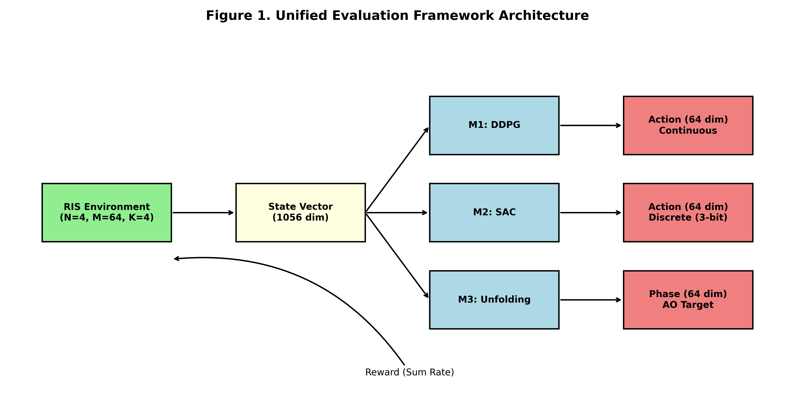
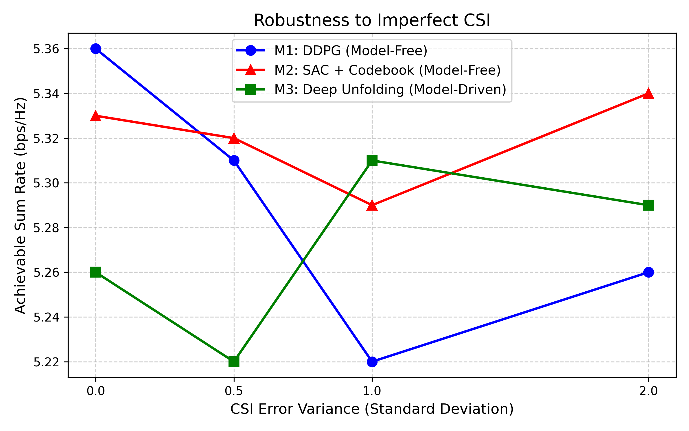

# Deep Reinforcement Learning for RIS Phase-Shift Optimization in 6G Networks


Code, trained models, and evaluation pipeline for a comparative study of **model-free Deep Reinforcement Learning** (DDPG, SAC) and **model-driven Deep Unfolding** for **Reconfigurable Intelligent Surface (RIS)** phase-shift optimization in 6G networks.

---

## Table of Contents

1. [Overview](#overview)
2. [Methods Compared](#methods-compared)
3. [System Model and Environment](#system-model-and-environment)
4. [Project Structure](#project-structure)
5. [Installation](#installation)
6. [Usage](#usage)
7. [Reproducibility](#reproducibility)
8. [Citation](#citation)
9. [License](#license)
10. [Contact](#contact)

---

## Overview

A Reconfigurable Intelligent Surface (RIS) is a passive surface made of many low-cost reflecting elements. Each element can shift the phase of an incoming signal, so the reflected waves can be steered toward a user. Choosing these phase shifts well can greatly improve coverage and data rate in 6G networks, but the problem is hard in practice because:

- The objective is **non-convex** (unit-modulus constraint on every element).
- **Channel State Information (CSI) is imperfect**, so the optimizer works with noisy estimates.
- Real hardware only supports **discrete phase values** (a 3-bit codebook here), not continuous ones.

This project benchmarks three learning-based approaches against a classical optimization baseline under these realistic conditions.

## Methods Compared

| ID | Method | Type | Notes |
|----|--------|------|-------|
| **M1** | DDPG | Model-free DRL | Continuous-action actor-critic |
| **M2** | SAC | Model-free DRL | Uses a **Gumbel-Softmax** relaxation to output a **3-bit discrete phase codebook** |
| **M3** | Deep Unfolding | Model-driven | Network unrolled from **Riemannian Conjugate Gradient** iterations |
| Baseline | Alternating Optimization (AO) | Classical | Riemannian gradient ascent; also used to produce the ground-truth dataset |

## System Model and Environment

The simulation environment is implemented in `ris_env.py`.

- **State dimension:** 1056
- **Action dimension:** 64 (one phase shift per RIS element)
- **Imperfect CSI:** the agent observes noisy channel estimates
- **Hardware constraint:** discrete phase resolution (3-bit codebook for SAC)


## Project Structure

```
Deep-Reinforcement-Learning-for-RIS-Phase-Shift-Optimization/
│
├── ris_env.py              # Unified 6G RIS simulation environment (state: 1056, action: 64)
├── ao_baseline.py          # Alternating Optimization (Riemannian gradient ascent) baseline
├── generate_dataset.py     # Generates the 10,000-sample AO ground-truth dataset
├── evaluate.py             # Unified evaluation pipeline for M1, M2, and M3
├── convert_models.py       # Model conversion / checkpoint utility
├── test_my_code.py         # Quick sanity tests
├── plot_final_figure2.py   # Generates the robustness graph (Figure 2)
├── generate_figure1.py     # Generates the architecture diagram (Figure 1)
│
├── train/                  # Training scripts for the models
├── eval/                   # Evaluation helpers
├── utils/                  # Shared utility functions
├── checkpoints/            # Intermediate training checkpoints
│
├── models/                 # Final trained weights (.pth)
│   ├── m1_ddpg_actor.pth
│   ├── m2_sac_actor.pth
│   └── m3_unfolding.pth
│
├── data/
│   └── ao_ground_truth.pt  # AO-generated ground-truth dataset
│
├── results/
│   ├── evaluation_results.txt
│   └── raw_eval_data.csv
│
├── figures/                # Plots used in the manuscript
│   ├── figure1_architecture.png
│   └── figure2_robustness.png
│
└── docs/                   # Additional documentation
```

## Installation

**1. Clone the repository**

```bash
git clone https://github.com/Balrajsingh2044/Deep-Reinforcement-Learning-for-RIS-Phase-Shift-Optimization.git
cd Deep-Reinforcement-Learning-for-RIS-Phase-Shift-Optimization
```

**2. Create a virtual environment (recommended)**

```bash
python -m venv venv
source venv/bin/activate        # Linux / macOS
venv\Scripts\activate           # Windows
```

**3. Install dependencies**

```bash
pip install torch numpy scipy matplotlib pandas
```


## Usage

### 1. Sanity check

```bash
python test_my_code.py
```

### 2. Generate the AO ground-truth dataset

```bash
python generate_dataset.py
```

Produces `data/ao_ground_truth.pt` (10,000 samples).

### 3. Train the models

Training scripts live in the `train/` folder. Run the script for the method you want, for example:

```bash
python train/<script_name>.py
```


### 4. Evaluate all methods

```bash
python evaluate.py
```

Writes `results/evaluation_results.txt` and `results/raw_eval_data.csv`.

### 5. Reproduce the figures

```bash
python generate_figure1.py      # architecture diagram
python plot_final_figure2.py    # robustness graph
```

Outputs are saved to `figures/`.


### Architecture



### Robustness to Imperfect CSI



## Reproducibility

- Set random seeds for NumPy and PyTorch before training and evaluation.
- Pretrained weights are provided in `models/` so you can run `evaluate.py` without retraining.
- Report your Python, PyTorch, and CUDA versions if you share results.

## Citation

If you use this code in your research, please cite:

```bibtex
@misc{singh2026risdrl,
  author       = {Singh, Balraj},
  title        = {Deep Reinforcement Learning for RIS Phase-Shift Optimization in 6G Networks},
  year         = {2026},
  howpublished = {\url{https://github.com/Balrajsingh2044/Deep-Reinforcement-Learning-for-RIS-Phase-Shift-Optimization}}
}
```

## License

This project is released under the MIT License. Add a `LICENSE` file to the repository to make this official.

## Contact

**Balraj Singh**
GitHub: [@Balrajsingh2044](https://github.com/Balrajsingh2044)

Issues and suggestions are welcome via the [Issues](https://github.com/Balrajsingh2044/Deep-Reinforcement-Learning-for-RIS-Phase-Shift-Optimization/issues) tab.
